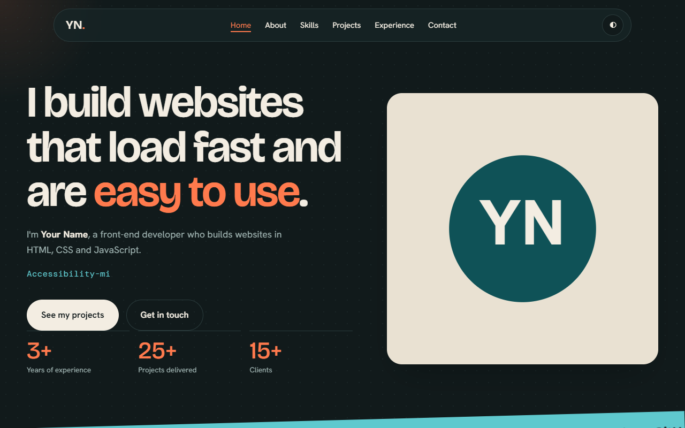
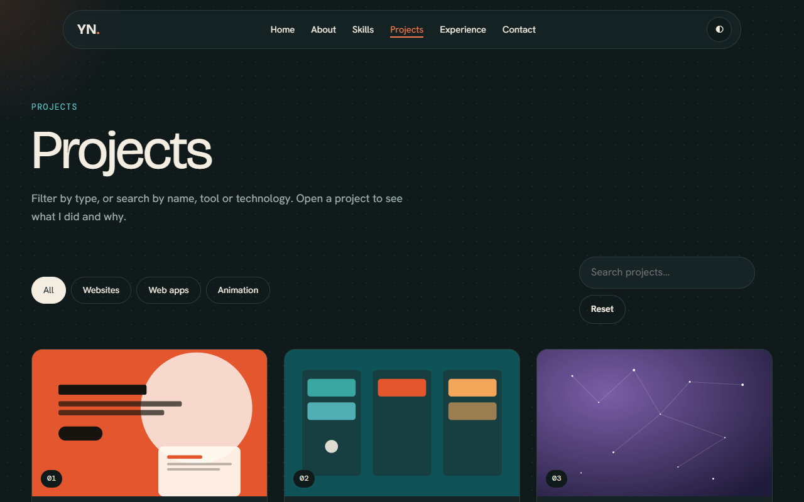

# Portfolio: HTML, CSS and JavaScript

An open-source, multi-page developer portfolio. No framework, no build step, no backend. It runs anywhere that serves static files.



<p align="center"></p>

## Pages

| Page | File | Contents |
| --- | --- | --- |
| Home | `index.html` | Intro, services, featured projects, skills preview, testimonials, call to action |
| About | `about.html` | Bio, facts, stats, education, certifications, "right now" list |
| Skills | `skills.html` | Skill groups with bars that animate on scroll |
| Projects | `projects.html` | Filter by category, search, reset |
| Project | `project.html?id=…` | Case study with image, highlights, tags and previous/next links |
| Experience | `experience.html` | Work history timeline |
| Contact | `contact.html` | Validated form, copy-email button, social links |
| Not found | `404.html` | Shown for unknown URLs |

## Features

- Light and dark theme, remembered per visitor, follows the system setting by default
- Scroll reveals, animated skill bars, count-up stats, typing effect, scroll progress bar
- Mobile menu (closes with Esc or after you pick a link)
- Search and category filters on the projects page, with a reset button
- Contact form with validation. It opens the visitor's mail app, so no server is needed
- Accessible: semantic HTML, skip link, visible focus styles, `prefers-reduced-motion` support
- Responsive from 320px to large desktops
- No JavaScript libraries. Only Google Fonts are loaded from the network

## Make it yours

You don't need to touch the HTML.

1. **`config.js`**: your name, initials, roles, tagline, footer line, email, résumé path and social links. Leave a value empty to hide it.
2. **`data.js`**: projects, services, testimonials, skills, experience, education, certifications and "right now" items.
3. **`assets/img/`**: replace `avatar.svg` with your photo (for example `avatar.jpg`, then update the `src` in `index.html` and `about.html`). Replace `project-01.svg` to `project-06.svg` with screenshots of your work. Use about 800×500 px.

**Before you publish:**
- Replace every `Client Name`, `Company Name`, `Agency Name` and `University Name` placeholder in `data.js`. Remove testimonials you cannot back up.
- Put your real domain in `sitemap.xml` and `robots.txt`.
- Keep private data (phone, home address, personal IDs) out of these files. The repo is public.

## Run it locally

```bash
npm start                  # http://localhost:8080 (uses npx serve, no install needed)
# or
python -m http.server 8080
```

Or double-click `index.html`. Pages and filters work, but a local server is more reliable.

## Docker

```bash
docker compose up --build        # http://localhost:8080
# or
docker build -t portfolio .
docker run -p 8080:80 portfolio
```

The image is `nginx:alpine`, serves pretty URLs, sets caching and security headers, and includes a health check.

## Free hosting

No build step is needed for any of these.

| Host | Steps |
| --- | --- |
| **GitHub Pages** | Push to `main`. `.github/workflows/pages.yml` deploys it. In Settings → Pages, set Source to **GitHub Actions**. |
| **Netlify** | Drag the folder onto app.netlify.com/drop, or import the repo. `netlify.toml` is included. |
| **Vercel** | Import the repo. Framework preset: Other. `vercel.json` is included. |
| **Render** | New → Blueprint, or Static Site with publish path `.`. `render.yaml` is included. |
| **Cloudflare Pages** | Connect the repo. No build command. Output directory: `/`. |
| **Any Docker host** | Use the `Dockerfile`. |

## Project structure

```
.
├── index.html · about.html · skills.html · projects.html
│   project.html · experience.html · contact.html · 404.html
├── style.css               design tokens, layout, animation, responsive rules
├── config.js               your personal settings (edit)
├── data.js                 your content (edit)
├── common.js               header, footer, theme, menu, renderers, form logic
├── assets/img/             avatar, favicon and project images (SVG placeholders)
├── robots.txt · sitemap.xml
├── Dockerfile · docker-compose.yml · nginx.conf · .dockerignore
├── netlify.toml · vercel.json · render.yaml
├── .github/workflows/pages.yml
└── package.json            npm start, npm run check
```

## Contributing

Issues and pull requests are welcome. Run `npm run check` before you open a PR.

## License

[MIT](LICENSE)
